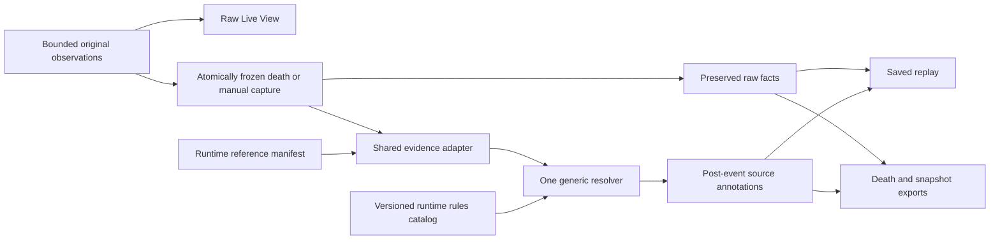

# Standard-build and single-resolver consolidation plan

Status, 20 November: the continuous-capture refactor passes 1,197 checks and
the standard build/API checks. Production source measures 215,446 tokens;
the strict below-200,000 review gate remains open. The public candidate is
unchanged. See HANDOFF.md for the current checkpoint and validation scope.

## Objective and release gates

Keep the current standalone recording, analysis, replay and export functionality,
while replacing overlapping attribution machinery with one data-driven resolver.
Use RuneLite's standard build and reduce the implementation enough for review.

Both requirements are mandatory: preserved functionality **and** acceptable review
size. A smaller plugin with missing features is not completion. Passing tests
without meeting the review gate is not completion either.

The current public candidate is `bf19b988b53d3ec861d732671da35e1e7cdb76aa`.
Its tree matches local validated candidate `1505ed1653c8b7996a3880fb3aada99a41bb73b8`.
The Hub-published baseline remains `72b4aee221a4bd2c490eb0d52528b9ae68554323`.
[PR #20986](https://github.com/runelite/plugin-hub/pull/20986) is blocked on
standard packaging and review size: **302,079 tokens against a 200,000 limit**.
Those submission measurements are separate from the current refactor's size.

### Reviewer's clarified requirements

[The reviewer](https://github.com/runelite/plugin-hub/pull/20986#issuecomment-7017065819)
requires `build=standard` and readable code, without minification or obfuscation.
Their suggested reductions are Lombok boilerplate removal, wildcard imports,
RuneLite utilities, reference data in resources, and keeping test code out of
`src/main`. Comments, resources, test sources and the README do not count toward
the limit. Removing documentation or tests cannot solve this review problem.

The combined refactor passes the full regression suite and builds with the
official standard template. It has one runtime evaluator; frozen previous
implementations remain in tests. These results do not satisfy the separate
review-size gate.

## Intended end state

Encounter-specific identities, signals and mechanics belong in reviewed data.
Java captures RuneLite observations and implements reusable matching operations.
It must not contain separate handlers for individual bosses or NPC IDs.

Live View renders original observations without attribution. Death and manual
capture freeze one window, then a background worker indexes it, runs the one
evaluator and prepares saved replay/export. The journal is a generated view;
it is not a second recording store. Identical observations, window boundaries
and data versions must produce equivalent results.

Raw facts remain usable independently of attribution. Missing rules preserve
observed API source evidence and the existing alternatives/Unknown behaviour.

### Data responsibilities

One versioned runtime catalog supplies the executable facts currently spread
across `damage_map.json`, `combat_catalog.json` and `resolver-v1.json`:

- Actor identities, variants, roles and factual labels consumed by capture/UI.
- Animation, projectile, graphic, object, interaction and response bindings.
- Attack components, recipient rules, necessary spatial envelopes and timing.
- Hitsplat families/masks, status interpretation, protection and mode qualifiers.
- Component limits, separately qualified whole-source limits and bounded formulas.
- Non-damaging activity, passive-source associations and supported-reference needs.

The catalog contains structured facts and predicates, not executable scripts or
instructions to an AI. Research authoring, source passages and compiler checks
remain available in the research workspace. Runtime data retains the references
needed to inspect its actual rules. Data reduction must remove genuinely unused
material or equivalent duplication, not conceal executing logic from reviewers.

Java retains the finite generic operations: capture, identity/native-scope checks,
original-clock fact selection, three-state conditions, outcome compatibility,
geometry, timing, qualified limits, candidate reconciliation and serialization.
A new encounter should normally require data entries, not a named Java branch.

## Functionality contract

The following must survive consolidation:

- Automatic deaths; immediate-revival handling; Live View; pause/save snapshots;
  saved/recent recording management; playback controls; current UI and telemetry.
- Every currently captured channel: actors, other observed players, equipment,
  inventory, projectiles/history, graphics, objects, floor/terrain, collision,
  variables, actions, effects and callback availability.
- Recorded hit amounts, zeroes/types, recipients, ownership, event ordering,
  ticks/cycles, actor generations and native scene/view/plane identities.
- The schema 1.3 export contract, lossless transport, save recovery/migration and
  background storage/copy behaviour. Internal representation may change while
  documented field meanings and recorded facts remain intact.
- All existing attribution capabilities, including ambiguous named alternatives,
  exclusions, confidence limits and generic handling of unknown content.
- The distinction between observed facts and derived annotations. Later state
  must not fill missing original observations or manufacture stronger evidence.
- Current retrospective presentation and RuneLite compliance boundaries.

This is a refactor of current capabilities, not a claim that every encounter is
already accurately attributed. Current coverage limitations are recorded as the
baseline; the refactor may not silently introduce more of them.

### Current recordings and older derived verdicts

The user's existing scope makes older exports best effort. The active resolver
therefore interprets original callbacks, witnesses and their recorded clocks.
It does not reconcile a previous resolver's exclusions or confidence labels as
additional evidence. Its own earlier annotations cannot feed back into a later
window and strengthen the same conclusion.

An older annotation can remain unchanged as a best-effort fallback when the
recording supplies no admissible current cue. It never becomes new proof.
Original recorded values and witnesses remain intact. Comparisons of retained
older captures must distinguish raw-fact regressions from changes caused by
removing prior-verdict reconciliation. Current capture capabilities and their
negative controls remain mandatory.

Unused legacy evaluators and their recorder/reference dependencies are retained
under `src/test` as explicit reference implementations. They are not packaged or
called by production. This preserves their assertions during migration and
allows actual production-size measurement; it does not establish that the new
path has passed those behaviour comparisons.

### Standard-build metadata boundary

The standard Hub build does not run our custom metadata generator. Merely setting
`build=standard` currently disables supported status/graphic/mode interpretation.
That downgrade is forbidden by this plan.

A small committed **runtime reference manifest**, separate from compile
provenance, will identify reviewed client versions, reference artifacts and the
six selected class hashes. Actual loaded version/class witnesses must qualify
the same supported interpretations. Missing/mismatched references stay unknown
without stopping raw capture.

Compile/source provenance is a separate diagnostic concern. Preserve accurate
values wherever the standard pipeline actually supplies them; unavailable
compile observations must stay explicitly unknown. Do not relabel a reference
manifest as proof of the actual compiler/classpath or invent a source hash.
The exact field-level treatment is a Phase 0 acceptance item, not permission to
drop metadata silently. It must not disable any existing matching capability.

## Implementation sequence

### 0. Freeze behaviour and establish a feasible code budget

Preserve the current candidate, data and test artifacts on an isolated baseline.
Develop on a dedicated local branch/worktree; leave the submitted candidate intact.

Create a responsibility inventory covering the two named engines **and** the
producer-side verdict logic in `resolvePendingHitsInScope`,
`matchPendingProjectile` and the mutable `lastAttribution*` fields. Capture of
actual ownership remains factual; inferred verdicts belong to the one evaluator.

For each existing behaviour, record its current owner, consumed data, proposed
owner and proving cases. Seal semantic baseline outputs for existing cases and
retained recordings. Inventory export fields and build-metadata availability.

Measure review tokens by responsibility using RuneLite's counting method if
available. If only a local proxy is available, document its method and discrepancy
from the known 302,079 baseline. Set a local target of **180,000** for headroom;
only the official result establishes compliance with its 200,000 limit.
Check that the proposed deletions/replacements can plausibly meet that budget
without losing the functionality above before undertaking broad migration.

**Exit:** a complete owner/migration matrix, baseline outputs, field contract and
measured reduction budget. Any unresolved functionality conflict is reported here.

### 1. Make the actual standard package function correctly

Separate runtime-reference qualification from generated compile metadata. Ship
the reviewed reference manifest as an ordinary resource and switch to standard
mode. Local development tasks may assist testing; runtime correctness must not
depend on custom build steps.

Validate an isolated build using the official replacement build/settings and
only committed production resources. Exercise the resulting JAR without a
development classpath supplying missing resources. Preserve all seven guarded
status interpretations, seven graphic references and ToA mode interpretation,
including dependent poison/venom transition attribution.

**Exit:** standard-package behaviour matches the baseline on supported references;
missing/changed references fail safely; absent compile metadata does not disable
supported functionality. Compilation alone does not pass this phase.

### 2. Consolidate mechanics data and original-evidence normalization

Use the existing resolver-v1 contract as the starting point, not a second new
framework. Extend it only where a currently consumed legacy behaviour needs a
reusable operator. Build one deterministic runtime projection from the research
inputs, and one adapter preserving original observations and uncertainty.

Every consumed legacy declaration needs a semantic destination. Grouping rows
is allowed only when identity, applicability, authority and outcomes are
equivalent. Rule counts alone do not prove parity. A table is not unused merely
because the retained sample recordings do not exercise its IDs; dynamically
addressable labels and references must survive their supported consumers.

**Exit:** every old runtime lookup and behaviour has a mapped canonical owner,
including the migration inventory below. Do not delete old implementations yet.

### 3. Migrate all attribution entry points to that implementation

Migrate by behaviour groups: direct/projectile; contact/area; status/interaction;
retaliation/lifecycle. Include all eight existing resolver patterns.

`resolveRecordedSources` and `WorldSnapshotRecorder.completeExport` become thin
callers of the same adapter/evaluator/result projection. Move producer-side
inferred source, timing and confidence decisions into it as well. Preserve the
actual original source/history observations that feed those decisions.

Keep interpretation over immutable, bounded observations. Preserve current
delivery/finalization behaviour and asynchronous saving/export; do not introduce
full scans, disk work or synchronous inference pauses on game/UI threads.
Cache by actual evidence window/revision and data version, not merely hit number.

Use temporary differential checks outside production to compare old and new
semantics. Retain meaningful assertions when private implementation classes go
away; do not delete failing assertions just to permit deletion of a class.

**Exit:** every live/death/snapshot/export path uses the same interpreter and
passes its semantic parity cases. No legacy verdict path remains active.

### 4. Delete replaced code and prove genuine size reduction

Remove `RecordedSourceResolver` and its replaced per-family interpreters only
after their distinct behaviours pass the mapping and parity gates. Consolidate
duplicate conditions, qualification, result merging and catalog lookups.
Remove unreachable resources/fields only after all capture, UI and export
consumers have replacements.

Remeasure the complete candidate and review change against the still-published
Hub baseline, not merely the small delta since our unmerged submission. Report
review tokens, production Java, resource size and remaining responsibilities.
If further savings are needed, target demonstrated capture/identity/normalization
duplication behind the same parity gates.

**Exit:** genuine implementation reduction with no duplicated evaluator. Do not
minify Java, encode executable logic, remove evidence guards, weaken Unknown
handling or use several PRs to disguise unchanged complexity. If preserving
behaviour and meeting the size budget conflict, stop and present the measured
conflict; no feature removal or reduced inference is implicitly authorized.

### 5. Validate the final standard-built artifact

Run appropriate checks while each behaviour group changes, then one full final
suite/package pass after code is frozen. The baseline is 1,049 tests; test count
alone is not the contract. Every existing behaviour assertion must remain or have
an explicitly mapped equivalent on the canonical path.

Compare raw recording facts exactly and derived results semantically: source
identities/families, candidates, exclusions and their scope, certainty/unknown
state, original-clock basis and relevant attribution evidence. Case IDs cover
both successful attribution and unsafe exclusions. Any changed source judgement
requires explanation and an approved bug fix rather than being dismissed as
refactor noise. Algorithm-specific internal names may change; information may not.

Use the 109 shared cases, 528 qualified-bound cases and the three retained
recordings (146 damage rows/86 incoming) alongside producer and export checks.
Exercise simultaneous hits, zeroes, missing/changed reads, reused actors,
cross-native views, original projectile ownership, lifecycle ambiguity and
conditional protection/modes. Verify all current supported reference bindings.

**Exit:** standard-built JAR, full behavioural/data parity, no new unsupported
baseline case, clean current API scan and no capture/save/export regression.
No new videos or manual completion of every boss is a prerequisite.

### 6. Update the existing Hub PR

Prepare a clean public commit with the tested tree and update PR #20986. Retain
the plain retrospective release description. Record the actual official token
result and CI results. Resolve maintainer feedback without treating a successful
compile as approval. The original reviewed candidate remains recoverable.

**Exit:** the submitted standard-built candidate is below the official token
limit, CI passes, and RuneLite accepts the update. Review eligibility and actual
maintainer approval are recorded separately.

## Required migration inventory

| Current behaviour/input | Required canonical destination / deletion gate |
| --- | --- |
| 3,155 ordinary attribution declarations | Identity/profile/condition rules; every consumed variant and qualifier accounted for. |
| 106 whole-source and 8 additional component declarations | Distinct scoped limits, outcomes and original-context guards preserved. |
| 18 spatial and 9 actor/lifecycle mechanism rules | Shared geometry, temporal and lifecycle operators with original anchors. |
| 17 NPC contact hints and 5 graphic cues | Original contact/effect evidence distinct from later settled hints. |
| 2 projectile endpoint hints and source histories | Immutable original ownership, generation, endpoint and flight evidence. |
| Activity and unknown-content candidates | Generic observed-source fallback independent of a named catalog entry. |
| 1 possession-only inventory hint | Possible possession association; never fabricate use, quantity or damage. |
| 2 response-text hints and 20 self-input constraints | Requests, responses, consumption and possession remain distinct. |
| 5 compatibility rules and 8 cue bindings | One outcome/signature admission path; preserve zero/resource/mixed distinctions. |
| Current 573 profiles, 443 specials and 106 bounds | Canonical evaluator coverage, not a claim that legacy paths are already replaced. |
| 3 activity classifications and 2 passive associations | Cue-specific exclusion and weak presence, with their existing uncertainty. |
| Status, graphic and mode bindings | Accurate standard-build-compatible reference qualification. |
| Identity, role, symbol and context tables | Preserve all capture/UI/export consumers, not only damage matching. |
| Source reconciliation and derived launch/confidence fields | One result projection; raw hit/actor/event identity and evidence retained. |
| Save/copy/compaction and presentation | Same complete facts, settings, recovery and asynchronous delivery behaviour. |

## Definition of done

- [ ] Baseline functionality and metadata contracts are explicit and mapped.
- [ ] Standard Hub packaging preserves supported recording and interpretation.
- [ ] Encounter-specific mechanics are in versioned data, not Java branches.
- [ ] Exactly one evidence adapter, rule evaluator and result projection serves all entry points.
- [ ] Producer-side hidden verdict logic and replaced legacy engines are removed.
- [ ] Every consumed legacy behaviour/data input has a proven destination.
- [ ] No recorded game facts, user features or baseline attribution capability are lost.
- [ ] No new certainty, extra Unknowns or missing alternatives are hidden as refactoring.
- [ ] Current export/schema/transport, storage and UI contracts remain functional.
- [ ] Final tests, standard-package checks, reference gates and API scan pass.
- [ ] Actual official review tokens are below 200,000; local headroom target is 180,000.
- [ ] The same existing PR passes its checks and receives RuneLite approval.

No runtime code, build setting, mechanics data or public PR is changed by writing
this plan. Implementation starts only as a separate, explicitly tracked phase.
